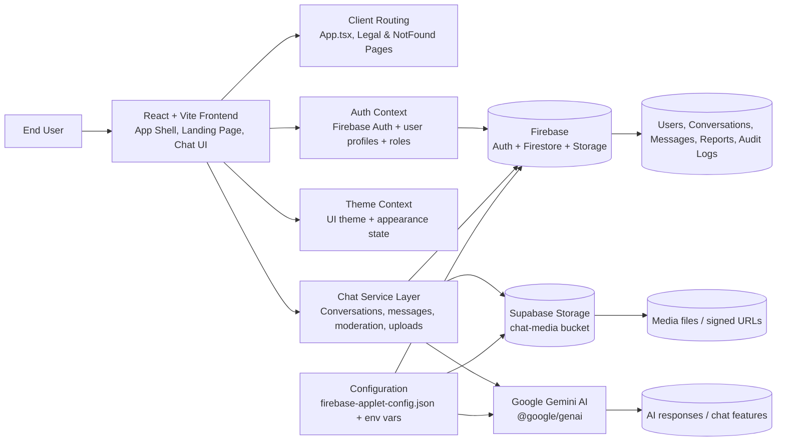

# ChatPro Architecture Overview

## Architecture Notes

- Frontend: Vite + React 19 app serving the client UI, auth flow, routing, and chat experience.
- State layer: `src/context/AuthContext.tsx` and `src/context/ThemeContext.tsx` manage user authentication, online state, profile data, and theme behavior.
- Service layer: `src/services/chatService.ts` handles direct/group conversations, message operations, read receipts, moderation, reports, and file/media uploads.
- Data layer: Firebase provides authentication, Firestore document storage, and storage for app data. Supabase is used for media upload and signed URL access.
- AI integration: the app uses the Google GenAI client for AI-powered chat capabilities.
- Configuration: environment variables and Firebase app config are loaded at startup to wire the browser app to backend services.
